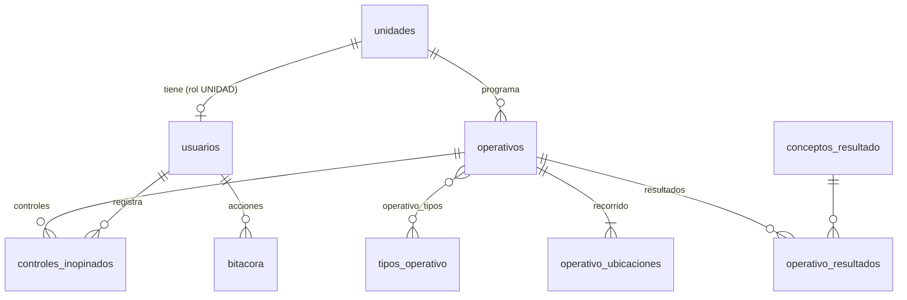

# 02 · Modelo de datos

La estructura completa está en `sql/001_esquema.sql` y los catálogos iniciales en `sql/002_datos_iniciales.sql`.
Motor: MySQL 8 o MariaDB 10.6+, con `utf8mb4` y tablas InnoDB.

## Diagrama



## Tablas

| Tabla | Contenido | Claves y notas |
|---|---|---|
| `unidades` | Las 26 comisarías y unidades | `division`: `DIVOPUS`, `DUE` o `DIVINCRI`. `nombre` es el nombre completo y `nombre_corto` el que se muestra en el mapa. |
| `usuarios` | Cuentas del sistema | `rol`: `ADMIN`, `SUPERVISOR` o `UNIDAD`. `unidad_id` es único: una cuenta por unidad. Las cuentas ADMIN y SUPERVISOR tienen `unidad_id` NULL. |
| `tipos_operativo` | Catálogo: control de identidad, rastrillaje, etc. | Lo administra ADMIN. |
| `conceptos_resultado` | Catálogo: detenidos en flagrancia, papeletas IRNT, etc. | Lo administra ADMIN. El formulario de cierre se genera a partir de este catálogo. |
| `operativos` | Un registro por unidad, fecha de servicio y turno | **Clave única** `(unidad_id, fecha_servicio, turno)` (RN-01). `estado`: `PROGRAMADO`, `EN_CURSO` o `FINALIZADO`. |
| `operativo_tipos` | Relación N:M entre operativo y tipos | Clave primaria compuesta. |
| `operativo_ubicaciones` | Puntos del recorrido | La última por `registrado_en` es la posición actual. `origen` es `GPS` (con precisión en metros) o `MANUAL` (sin precisión), RN-09. |
| `operativo_resultados` | Cantidad por concepto | Clave primaria `(operativo_id, concepto_resultado_id)`. Se crean al finalizar. |
| `controles_inopinados` | Controles del General | `distancia_m` se calcula con Haversine contra la última ubicación del operativo. |
| `bitacora` | Auditoría de acciones | Es obligatoria porque las cuentas de unidad son compartidas (RN-17). |

## Decisiones de diseño

- **`turno`** se guarda como `ENUM('MANANA','TARDE','NOCHE','MADRUGADA')`, sin Ñ en el código. En pantalla se muestra "MAÑANA". No lo elige el usuario: lo calcula `clasificar_turno()` a partir de la hora de inicio (RN-02). `MADRUGADA` se agrega con `sql/003_turno_madrugada.sql`.
- **`fecha_servicio` es la jornada** (de 06:00 a 05:59 del día siguiente), no necesariamente el día calendario del inicio: el turno MADRUGADA empieza el día siguiente a su `fecha_servicio`.
- **`inicio_programado` y `fin_programado` son DATETIME**, no TIME, porque la MADRUGADA empieza al día siguiente y los operativos pueden cruzar la medianoche (RN-02).
- **Origen de la ubicación** (RN-09): `operativo_ubicaciones.origen` y `controles_inopinados.origen`, como `ENUM('GPS','MANUAL')`. Se agregan con `sql/003`. Las filas existentes quedan como `GPS`.
- **Grado del jefe**: lista fija en la constante `GRADOS` de `app/dominio.php`. No se crea una tabla, porque no cambia. Se sigue guardando en `jefe_grado VARCHAR(30)`.
- **Cierre de sesiones** (RN-19): `usuarios.version_sesion` (entero) se incrementa al resetear la clave o desactivar la cuenta. Cada petición compara el valor guardado en la sesión con el de la base de datos y cierra la sesión si no coinciden. Se agrega con `sql/003`.
- **Las coordenadas son `DECIMAL(10,7)`**, que da precisión de alrededor de 1 cm. No se usan tipos espaciales, porque no hacen falta sin jurisdicciones.
- **Los resultados están normalizados** (una fila por concepto), así que el reporte de la fase 2 se resuelve con un `SUM ... GROUP BY`, y agregar un concepto nuevo no requiere modificar tablas.
- **Los estados derivados no se guardan**: se calculan en la consulta (ver abajo) o en `app/dominio.php`.
- **No se usan `CHECK` constraints**, porque no todos los hostings los respetan. Las validaciones (RN-04, RN-20) van en PHP.

## Consultas de referencia

**Mapa: operativos vigentes con su última ubicación**

```sql
SELECT o.*, u.nombre_corto,
       ub.latitud, ub.longitud, ub.precision_m, ub.registrado_en AS ubicacion_en,
       CASE
         WHEN o.estado = 'PROGRAMADO' AND NOW() > o.inicio_programado + INTERVAL 15 MINUTE THEN 'NO_INICIADO'
         WHEN o.estado = 'EN_CURSO'   AND NOW() > o.fin_programado   + INTERVAL 30 MINUTE THEN 'SIN_CIERRE'
         ELSE o.estado
       END AS estado_visible,
       (o.estado = 'FINALIZADO' AND o.nota_informativa IS NULL) AS pendiente_nota
FROM operativos o
JOIN unidades u ON u.id = o.unidad_id
LEFT JOIN operativo_ubicaciones ub ON ub.id = (
    SELECT id FROM operativo_ubicaciones
    WHERE operativo_id = o.id
    ORDER BY registrado_en DESC, id DESC LIMIT 1)
WHERE o.fecha_servicio = :jornada
   OR (o.fecha_servicio = :jornada - INTERVAL 1 DAY AND o.estado = 'EN_CURSO');
```

`:jornada` es la jornada vigente (`fecha_servicio_vigente()`). La segunda condición mantiene en el mapa los operativos de la jornada anterior que siguen en curso, porque no hay duración máxima. Las tolerancias se pasan como parámetros desde `app/config.php`; aquí aparecen fijas solo como ejemplo.

**Reporte de la fase 2: resultados por unidad en un rango de fechas**

```sql
SELECT u.nombre_corto, c.nombre AS concepto, SUM(r.cantidad) AS total
FROM operativo_resultados r
JOIN operativos o ON o.id = r.operativo_id
JOIN unidades u ON u.id = o.unidad_id
JOIN conceptos_resultado c ON c.id = r.concepto_resultado_id
WHERE o.fecha_servicio BETWEEN :desde AND :hasta
GROUP BY u.id, c.id
ORDER BY u.orden, c.orden;
```

**Cumplimiento: operativos programados contra ejecutados**

```sql
SELECT u.nombre_corto,
       COUNT(o.id)                                    AS programados,
       SUM(o.estado IN ('EN_CURSO','FINALIZADO'))     AS ejecutados,
       SUM(o.estado = 'PROGRAMADO' AND NOW() > o.inicio_programado + INTERVAL 15 MINUTE) AS no_iniciados
FROM unidades u
LEFT JOIN operativos o ON o.unidad_id = u.id AND o.fecha_servicio BETWEEN :desde AND :hasta
WHERE u.activo = 1
GROUP BY u.id
ORDER BY u.orden;
```

Los turnos `SIN_PROGRAMAR` de cada unidad son `4 × días del rango − programados`. En el tablero de una jornada, cada celda sin fila en `operativos` es `SIN_PROGRAMAR`.

> `NOW()` depende de la zona horaria de la conexión: `app/db.php` ejecuta `SET time_zone = '-05:00'` al conectar (ver 03).
